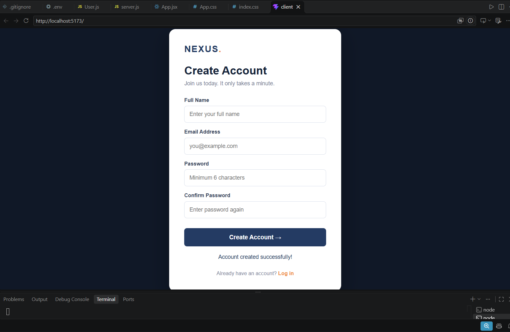

# MERN Signup Application

A full-stack user registration application developed using the MERN stack.

## Project Screenshot



## Technologies Used

- **MongoDB Atlas** – Database to store registered users.
- **Express.js** – Backend framework.
- **React.js** – Frontend user interface.
- **Node.js** – Server runtime.
- **CSS** – Frontend styling.
- **Bcrypt.js** – Password hashing.

## Features

- User registration with name, email and password.
- Password confirmation.
- Password hashing using bcrypt.
- Email uniqueness validation.
- MongoDB database integration.
- REST API for user registration.
- Success and error messages.

## Project Structure

```text
mern-signup/
├── client/
│   └── src/
├── server/
│   ├── models/
│   │   └── User.js
│   └── server.js
├── screenshots/
│   └── signup-page.png
├── .gitignore
└── README.md
```

## Installation and Setup

### 1. Install frontend dependencies

```bash
cd client
npm install
```

### 2. Install backend dependencies

```bash
cd server
npm install
```

### 3. Configure environment variables

Create a `.env` file inside the server folder:

```env
PORT=5000
MONGO_URI=your_mongodb_connection_string
```

### 4. Start the backend

```bash
node server.js
```

### 5. Start the frontend

Open another terminal:

```bash
cd client
npm run dev
```

Open http://localhost:5173/ in your browser.

## REST API

| Method | Endpoint | Description |
|---|---|---|
| POST | /api/signup | Register a new user |

## Database

MongoDB Atlas is used to store user information in the `signupDB` database and `users` collection.

Passwords are hashed using bcrypt before being stored.

## Author

Developed as part of the MERN Lab Assignment.